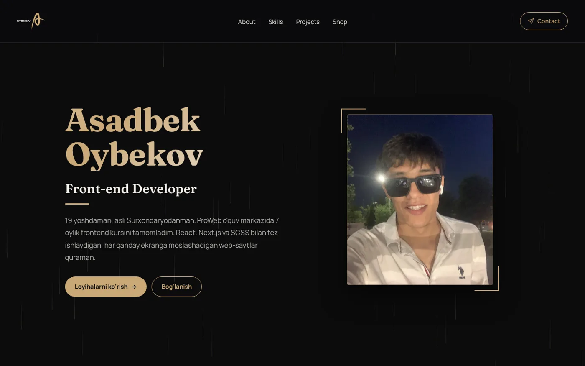

# Asadbek Oybekov — Front-end Developer Portfolio

Shaxsiy portfolio sayt: men haqimda, ko'nikmalar, loyihalar, API bilan ishlaydigan demo do'kon va Telegramga xabar yuboradigan aloqa formasi.



## Imkoniyatlar

- **Demo do'kon** — [dummyjson](https://dummyjson.com) API'dan mahsulotlar; qidiruv, kategoriya bo'yicha filtr, sahifalash, mahsulot sahifasi (rasmlar, reyting, sharhlar) va savatcha
- **Ma'lumotlarni keshlash** — TanStack Query orqali; sahifalar orasida yurganda qayta yuklanmaydi
- **Aloqa formasi** — validatsiya, spam-botlardan himoya (honeypot) va Vercel serverless funksiyasi orqali Telegram botga yuborish
- **Loyihalar karuseli** — avtomatik aylanish, swipe, klaviatura bilan boshqarish
- **Responsive** — telefon, planshet va kompyuter uchun moslashgan
- **Accessibility** — semantik HTML, `aria` atributlari, `prefers-reduced-motion` qo'llab-quvvatlanadi

## Texnologiyalar

React 19, Vite, React Router, TanStack Query, Axios, Framer Motion, SCSS Modules, Vercel (hosting + serverless API).

## Ishga tushirish

```bash
npm install
npm run dev      # lokal server
npm run build    # production build
npm run lint     # oxlint tekshiruvi
```

## Tuzilma

```
api/            # Vercel serverless funksiyalar (contact, order → Telegram)
src/
  api/          # API so'rovlar (dummyjson)
  components/   # Navbar, Footer, Background
  context/      # Savatcha holati (CartContext)
  pages/        # Home, About, Skills, Projects, Shop, Cart, Contact, Notfound
  images/       # rasm va logolar
  index.scss    # global stillar, ranglar va shriftlar (CSS o'zgaruvchilar)
```

## Aloqa

- Telegram: [@oybekovasadbek](https://t.me/oybekovasadbek)
- Email: oybekovasadbek650@gmail.com
- GitHub: [oybekovasadbek650-stack](https://github.com/oybekovasadbek650-stack)
